<div align="center">

# ▶ ClipMaster**Max**

### Turn long gameplay into viral Shorts, Reels & TikToks. On your own PC, for free.

**AI hype detection · word-synced captions in English, हिंदी and Hinglish · auto reframing · meme sound effects · game text pop-ups · 🤖 Auto Pilot · posting to YouTube Shorts & Instagram Reels**

Built for GTA 6. Works for any game: GTA 5, Valorant, BGMI, Free Fire, CoD, Fortnite, Minecraft, RDR 2…

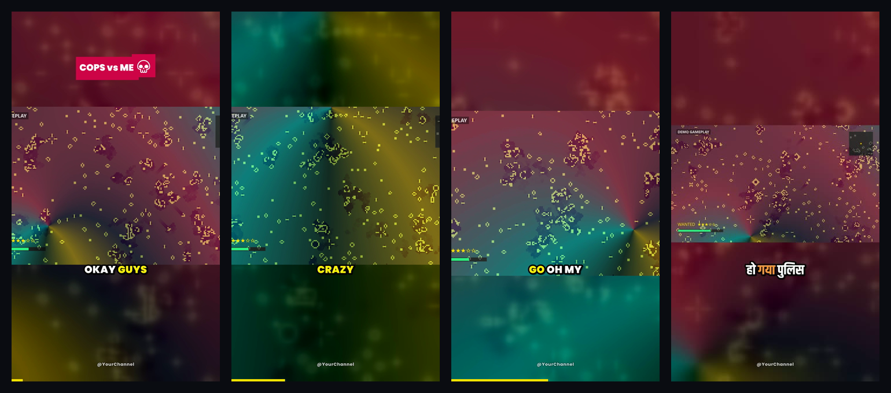

</div>

---

## ✨ What it does

| | Feature | Details |
|---|---|---|
| 🔥 | **Finds the hype moments for you** | Scans the audio for gunfire, explosions, crashes and screaming, scores every moment, and suggests ready-made clips from 15 s up to 3 min. |
| 🤖 | **Auto Pilot** | One click: finds the best moments, captions them, adds game text pop-ups, renders, writes titles/tags + an Instagram caption, and queues the posts. You can review everything before it goes live. |
| 🎯 | **Captions synced to every word** | Whisper large-v3 runs on your NVIDIA GPU and timestamps each word, so the active word lights up exactly when it's spoken. |
| 🇮🇳 | **English, हिंदी, Hinglish** | Write Hindi speech in Devanagari, in Roman letters ("bhai ye kya ho gaya"), or translated to English. |
| ✂ | **Cut out parts of a clip** | Remove boring bits anywhere inside a clip and keep the rest stitched together. **🤫 Remove silences** makes jump cuts in one click. Captions, sound effects and zooms stay in sync. |
| 🎨 | **10 caption styles** | Beast, Viral Green, Clean, Neon, Comic, Karaoke, One-Word, Fire, Desi (Hindi), Subtitle. You can change the font, colours, size, position, animation, glow and box. |
| 📱 | **Every format** | 9:16 Shorts/Reels/TikTok, 1:1, 4:5, 16:9. Framing options: **blur fill**, **crop**, **fit**, or **facecam on top + gameplay below**. |
| 💥 | **Retention effects** | Punch-zoom on hype moments, a big **hook title** in the first seconds, a progress bar and your watermark. |
| 💬 | **Text pop-ups** | Big bouncy text like "WASTED 💀" or "NO WAY 😱". **🔍 Find game moments** reads the game's own on-screen text (WASTED, ACE, BOOYAH, VICTORY ROYALE…) and adds pop-ups automatically, offline. |
| 🔊 | **Meme sound effects** | Bleep swear words with a beep, dolphin, boom or air horn. Auto **boom/air-horn on hype moments**, or a soundboard to drop sounds anywhere. All sounds are generated in the app, so they're copyright-free. |
| 🤬 | **Advertiser-friendly** | Censors English and Hindi swear words in the captions (f\*\*\*) and bleeps them in the audio. Loudness is normalised to YouTube's -14 LUFS. |
| 🚀 | **Fast, upload-ready export** | NVENC GPU encoding, H.264 High, up to 60 fps, AAC 192k, `.srt` captions, thumbnail maker. A 30 s Short renders in about 10 s. |
| 📈 | **Titles, description & tags** | Generates viral title ideas from what was said, plus an SEO description, hashtags and an **Instagram Reel caption**. |
| ▶ | **Post to YouTube + Instagram** | Post straight to YouTube Shorts (private, unlisted, public or scheduled) and Instagram Reels (now or scheduled), from your own accounts (optional). |
| 📤 | **Posts queue** | One page for every post: waiting for your OK, queued & scheduled, failed (with Retry) and posted. Edit the title or caption before it goes out. |
| ⚡ | **Batch mode** | Tick 10 clips, click once, and they're all captioned and rendered with your saved style. |
| 💾 | **Storage manager** | Free disk space whenever *you* choose. Nothing is ever deleted automatically. |

No subscriptions, no watermark, no upload limits. Your videos never leave your PC unless you post them.

---

## 🖥 Requirements

| | Minimum | Recommended |
|---|---|---|
| OS | Windows 10/11 (64-bit) | Windows 11 |
| GPU | Any (CPU works, just slower) | **NVIDIA GTX/RTX with 4 GB+ VRAM** (fast captions + NVENC export) |
| RAM | 8 GB | 16 GB |
| Disk | ~5 GB free (app + AI model) | SSD |
| Software | [Python 3.10+](https://www.python.org/downloads/) | FFmpeg is installed automatically if missing |

---

## 🚀 Install (one time)

**1. Download the code**

```powershell
git clone https://github.com/RajasDeshpande/ClipMasterMax.git
cd ClipMasterMax
```

…or click **Code → Download ZIP** on GitHub and unzip it.

**2. Double-click `setup.bat`**

It creates a private Python environment (`.venv`) and installs everything. If FFmpeg is missing it installs that with `winget`; in that case close the window and run `setup.bat` again.

**3. Double-click `start.bat`**

The app opens in your browser at **http://127.0.0.1:8765**. Keep the black console window open while you use the app.

> 💡 Running `start.bat` again **restarts** the app. It closes the old copy automatically, which is handy after updating the code with `git pull`.
>
> 🧠 The first time you generate captions, the AI speech model downloads (~3 GB for `large-v3`). Until then the app uses a smaller model, so you can start right away. After that everything works offline.

---

## 🎬 How to make your first clip (start → finish)

### Step 1: Start a project

Pick your game, then **drag in your gameplay recording** (MP4, MKV, MOV, WEBM… any length). You can also paste a link to *your own* YouTube video or stream (<kbd>Ctrl</kbd>+<kbd>V</kbd> into the *paste a link* box works).

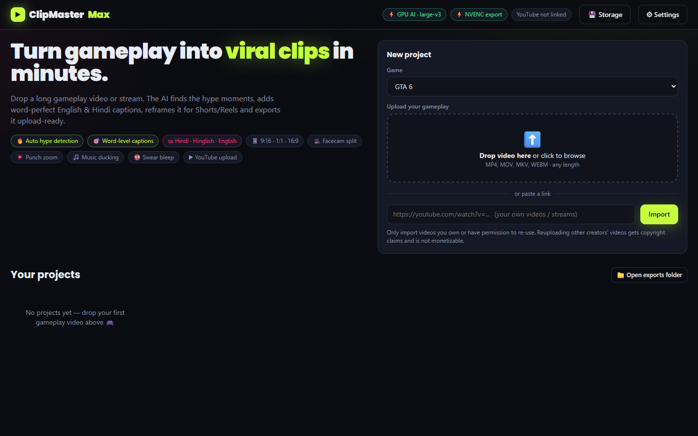

Importing a 1-hour video takes about a minute. The app reads the audio and finds the hype moments while it imports.

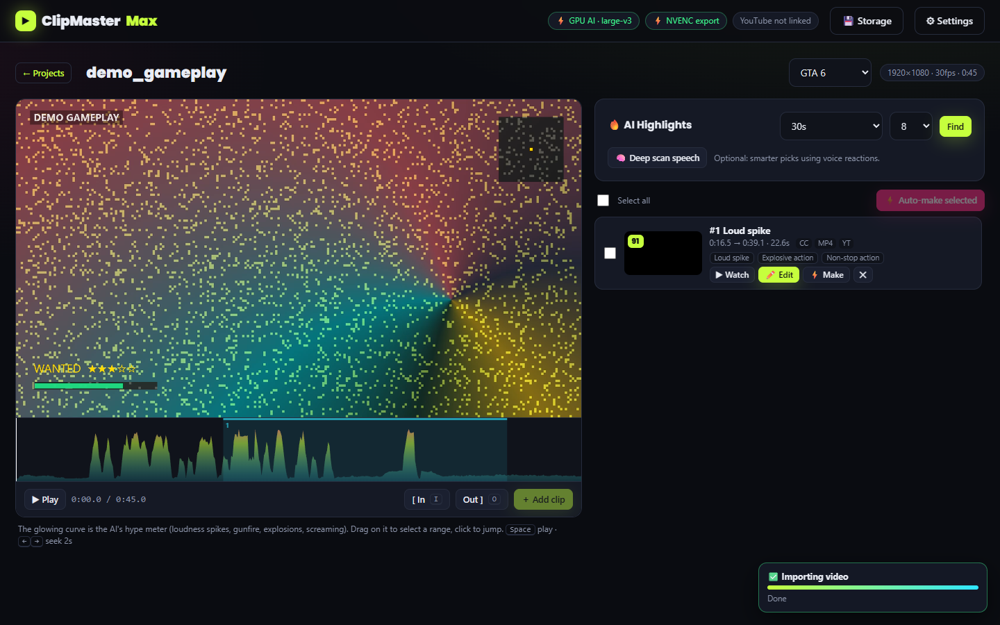

### Step 2: Pick your best moments

- The **glowing curve is the hype meter**. Peaks are gunfire, explosions, screaming and big reactions.
- The AI has already suggested clips (right side), each with a score and the reason it picked it.
- Change the length (15 s → 3 min) or the number of clips and press **Find**.
- **Drag on the timeline** to make your own clip, or use the <kbd>I</kbd> / <kbd>O</kbd> keys to mark in/out.
- Press **▶ Watch** to preview a clip, or **⚡ Make** to caption and render it with your default style in one click.

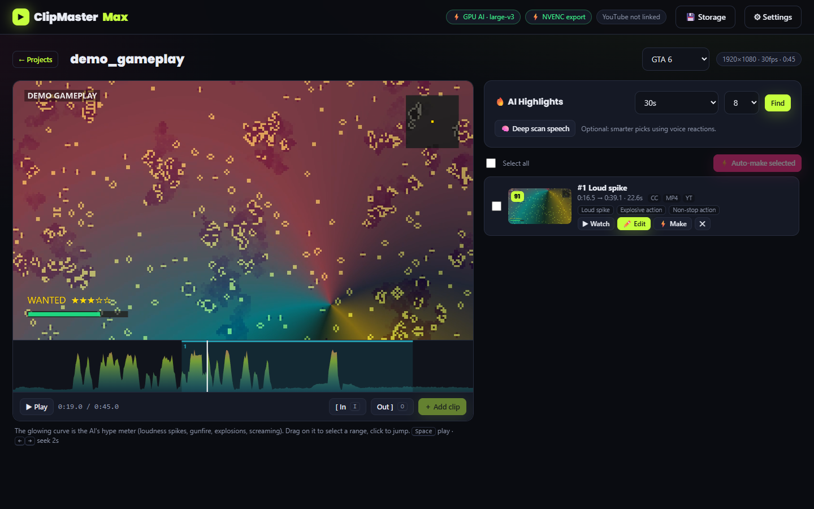

**Choose the captions for ⚡ Make & Auto-make.** In the **🔥 AI Highlights** card, under *💬 Captions for ⚡ Make & Auto-make*, there are two dropdowns:

- **Caption style**: any of the 10 presets.
- **Caption language**: **English** (default), **Hinglish** (bhai kya hua), **हिंदी** (Devanagari), **Hindi → English**, or **Auto-detect**.

Your choice is remembered for next time. The big pink **🤖 Auto Pilot** button is here too (see [Auto Pilot](#-auto-pilot-hands-free-clips) below).

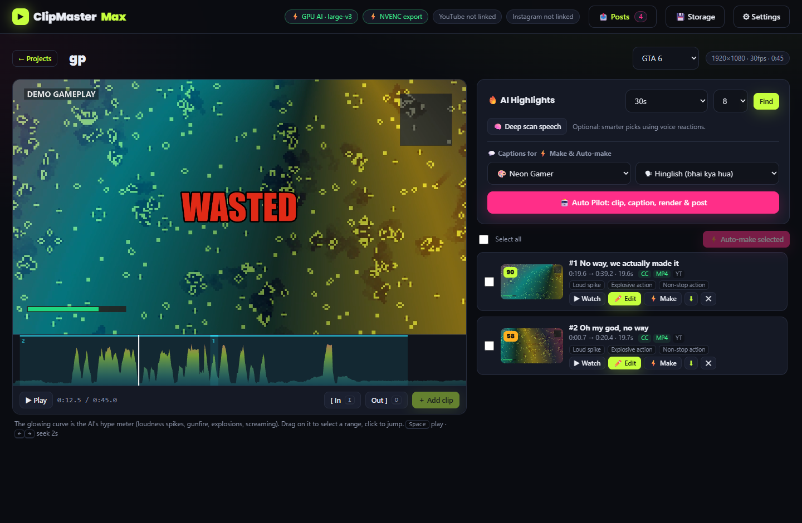

### Step 3: Generate captions

Open a clip with **✏️ Edit** and pick the spoken language (Auto / English / Hindi). New clips start in **English** by default. For Hindi, choose how it's written: **हिंदी**, **Hinglish** or **English** translation. Press **✨ Generate captions**: a 1-minute clip takes about 20 s on an RTX 3050.

- **Click** a word to jump to it. **Double-click** to fix it.
- Words the AI is unsure about are underlined orange.
- **Find & replace** fixes repeated mistakes in one go (names, gamer tags).
- Add names or slang under *Names / slang to recognise* (e.g. "Lucia, Jason, Vice City") to make recognition more accurate.

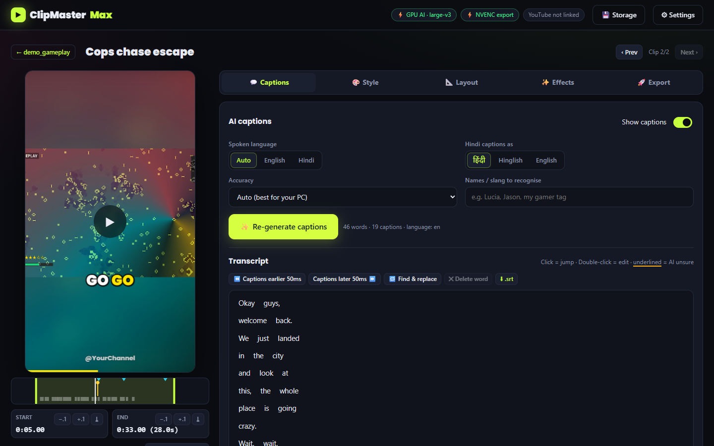

The hook title shows up big in the first seconds; this is the #1 trick for Shorts retention:

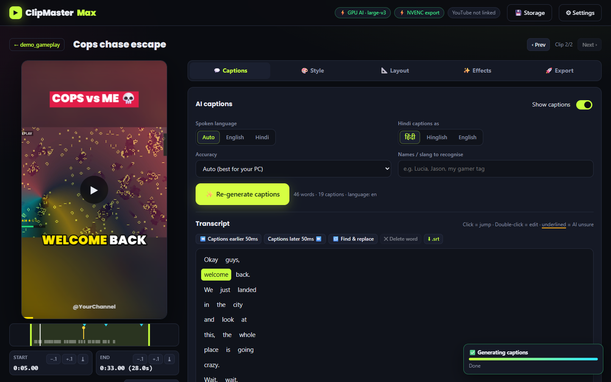

### Step 3½: Trim & cut out parts

- **Trim the ends:** drag the green handles on the bar under the preview, or use **−.1 / +.1 / ⤓ (set to playhead)** under *START* and *END*.
- **Cut out the middle:** remove a boring part anywhere inside the clip.
  - Press **[ Cut from here**, move the playhead, then press **Cut to here ]**. The keys <kbd>[</kbd> and <kbd>]</kbd> do the same.
  - Or **Shift + drag** across the bar.
- **🤫 Remove silences:** one click cuts out every pause where nobody talks, giving fast jump cuts (needs captions first).
- **What you see:** cut parts show red on the bar and their words are crossed out in the transcript. The preview skips cut parts while it plays, and *END* shows the final length.
- **Changed your mind?** Press **↺ Restore** on any cut in the list, or **↶ Undo** (<kbd>Ctrl</kbd>+<kbd>Z</kbd>).
- **On export:** the kept parts are stitched together, and captions, bleeps, sound effects and punch-zooms all move to the right moments.

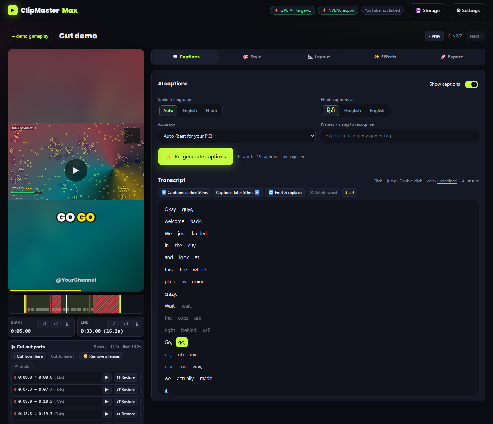

### Step 4: Style the captions

Choose a preset, then tweak the font, size, colours, outline, glow, animation, words per caption and position. The preview updates live. **⭐ Save as my default** makes every new clip use this look.

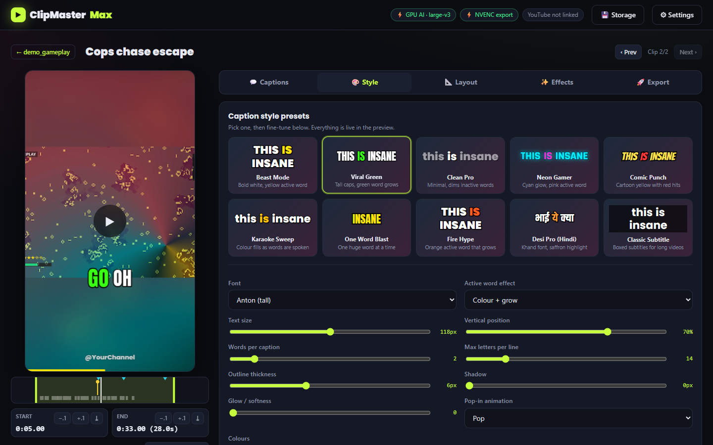

Hindi in Devanagari, with the **Desi Pro** style:

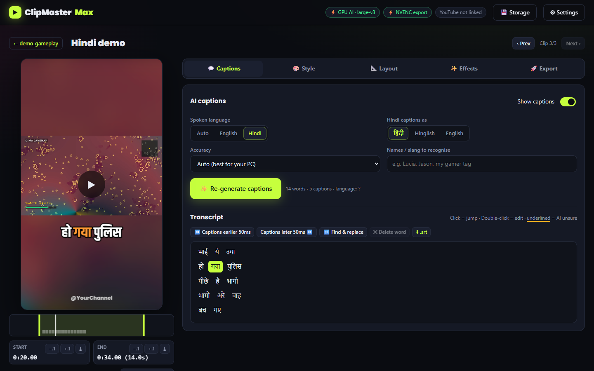

Prefer Roman letters? Switch to **Hinglish** and regenerate. The text comes out like "bhai ye kya ho gaya, police peeche hai":


### Step 5: Layout

Choose the format (9:16, 1:1, 4:5, 16:9) and the framing. With **Facecam + gameplay**, your webcam goes on top and the game below.

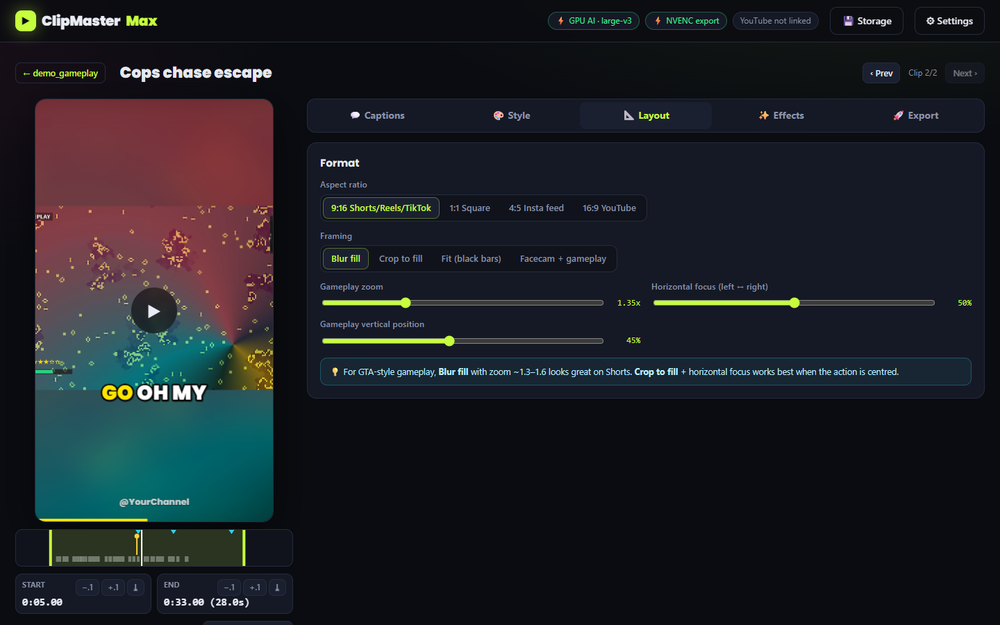

### Step 6: Effects, text pop-ups & sound effects

Hook title, punch-zoom, progress bar, watermark, music with auto-ducking, loudness normalising…

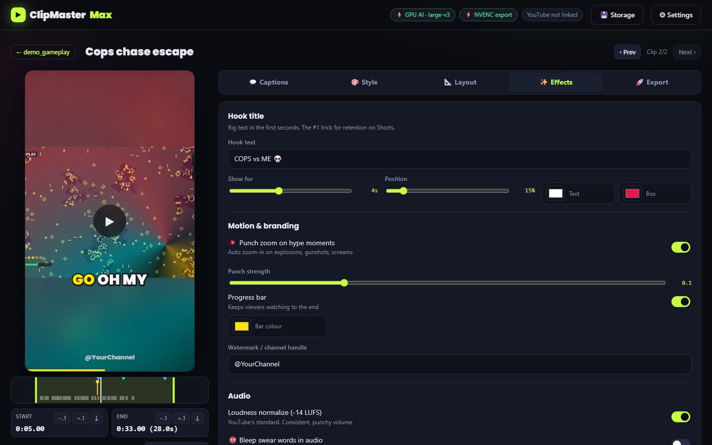

…**💬 text pop-ups**: big, bouncy, tilted text that pops on screen for a moment, like "WASTED 💀" or "NO WAY 😱".

- **Add your own:** type the text, pick a colour and duration, then press **＋ Add at playhead**.
- **Quick buttons:** WASTED 💀, NO WAY 😱, BRO WHAT 😭, LET'S GO 🔥, EZ 😎, RIP 💀, OOPS 🤡, CLUTCH 🧊.
- **🔍 Find game moments:** reads the game's own on-screen text (offline, on your PC) and adds pop-ups automatically:
  - GTA: *WASTED*, *BUSTED*, *MISSION PASSED*
  - Valorant: *ACE*, *CLUTCH*, *FLAWLESS*
  - BGMI: *CHICKEN DINNER* · Free Fire: *BOOYAH* · Fortnite: *VICTORY ROYALE* · Minecraft: *YOU DIED*
  - Any game: *VICTORY*, *DEFEAT*, *HEADSHOT*, *DOUBLE KILL* and more
- Every pop-up shows in the list with **Jump** and **✕** (remove). If you cut out parts of the clip, pop-ups move with the cuts.

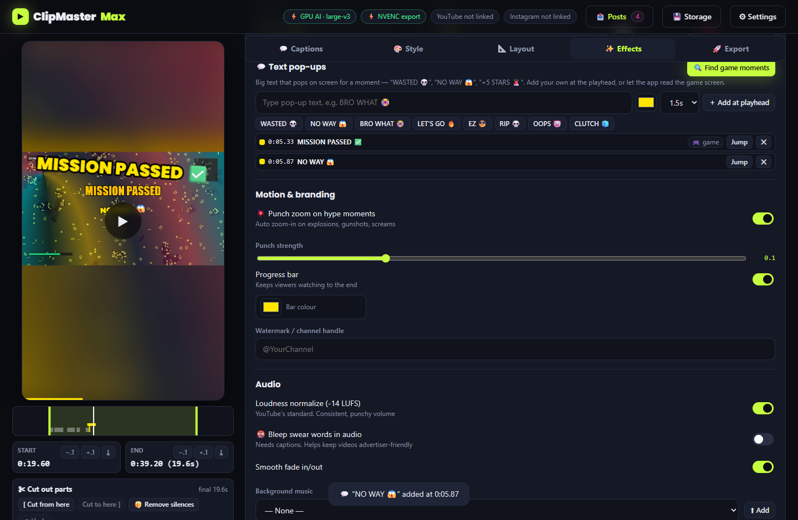

…and **sound effects**:

- **Bleep swear words**: choose beep, high beep, dolphin, boom, air horn, bruh, or mute only.
- **Auto sound on hype moments**: a boom or air horn plays on the biggest moments.
- **Soundboard**: tap a sound to drop it at the playhead. It shows as a coloured tick on the timeline.

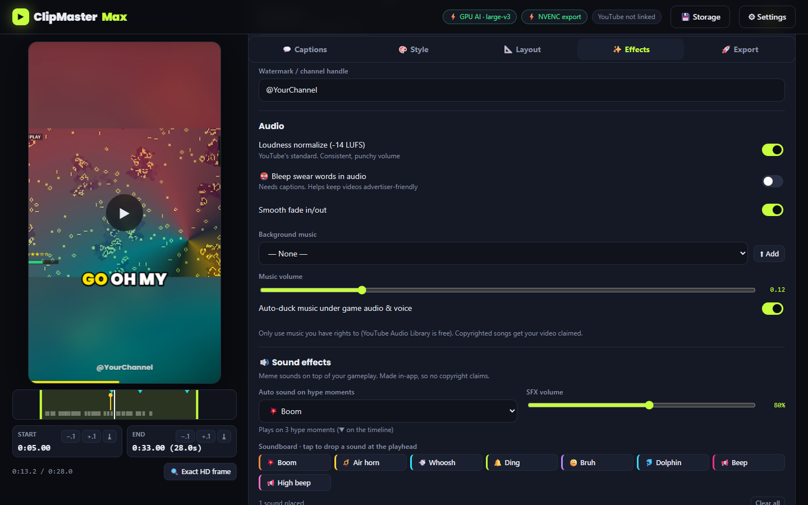

> 🔍 **Exact HD frame** (under the preview) renders a single frame through the real export engine, so you can check exactly how the final video will look.

### Step 7: Export

Press **🚀 Render video**. Then **Download MP4**, grab the `.srt`, or open the folder. Files are saved in `data/exports/<project name>/`.

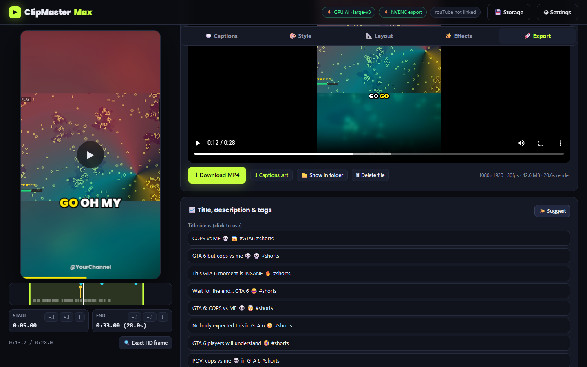

Press **✨ Suggest** for title ideas built from what was said, plus an SEO description and tags. Click a title to use it, and use the 📋 buttons to copy everything for Instagram or TikTok.

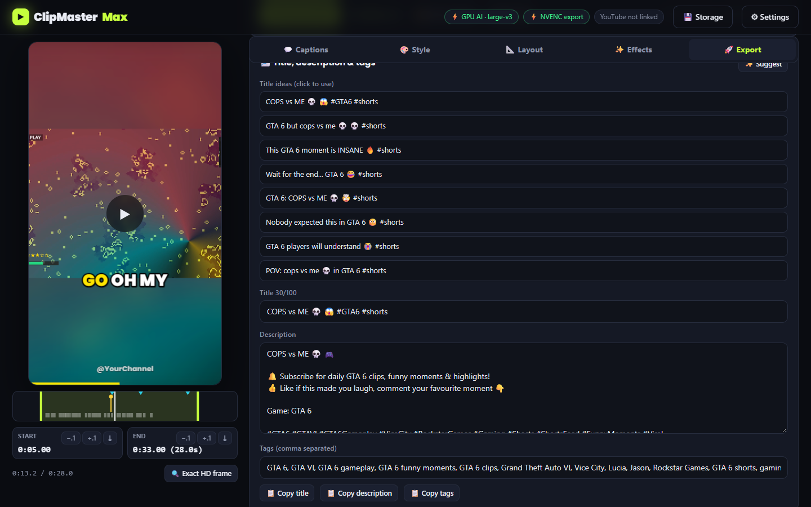

The **Title, description & tags** card also has a **📸 Instagram Reel caption** box (max 2200 characters, about 5 hashtags) with its own 📋 copy button.

### Step 8: Post to YouTube & Instagram

#### 📤 Post this clip (Export tab)

In the Export tab, the **📤 Post this clip** card lets you post the rendered clip:

- Tick **YouTube Shorts** and/or **Instagram Reel** (only accounts you've connected in Settings).
- Pick the **YouTube visibility** (private / unlisted / public).
- Optionally set **When** to schedule it for later. Leave it empty to post now.

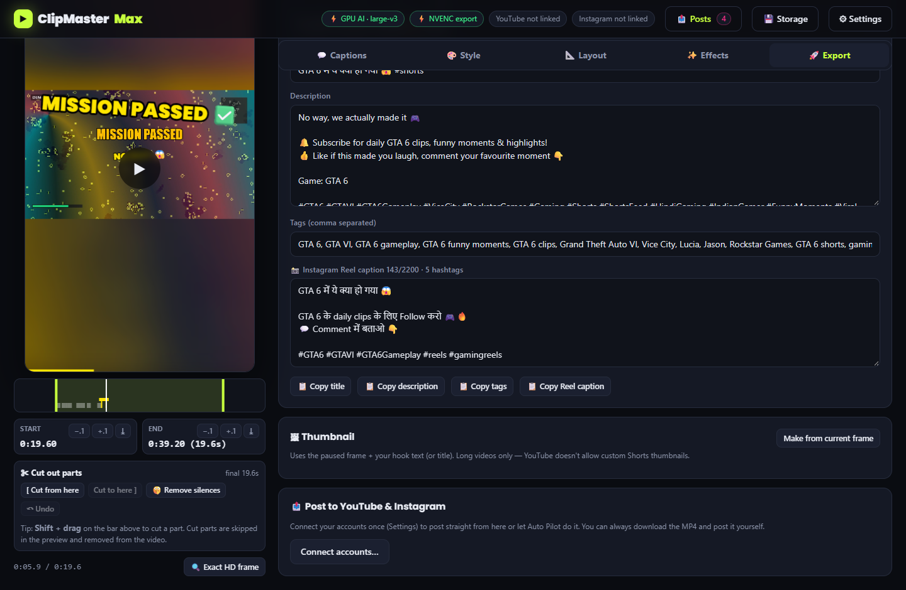

#### 📤 Posts page

Click **📤 Posts** in the top bar. The badge on the button counts posts waiting for your review. The page has four sections: **Waiting for your OK**, **Queued & scheduled**, **Failed** and **Posted**.

Each post card shows:

- A **platform badge** (YouTube or Instagram).
- Editable **title, description & tags** (YouTube) or **Reel caption** (Instagram).
- **🚀 Post now**, or pick a date-time and press **🗓 Schedule**.
- **Watch**, **Edit clip** and delete.
- Posted ones have **Open ↗** / **YouTube Studio** links. Failed ones show the error and a **Retry now** button.

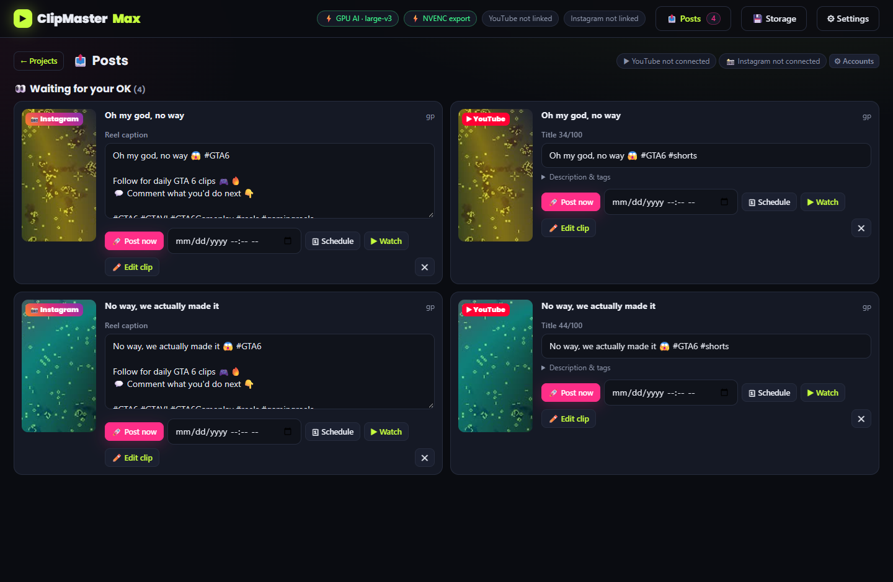

> ⏰ **Scheduling:** YouTube schedules are handled by YouTube itself (the video is uploaded now and goes public at your time), so your PC can be off. Instagram scheduled posts are sent by the app, so **ClipMasterMax must be running at that time**.

#### ▶ YouTube setup (one time)

Open **⚙ Settings** and follow the 5 steps once (about 5 minutes, free):

1. Open [Google Cloud Console](https://console.cloud.google.com/) and create a project.
2. Go to **APIs & Services → Library** and enable **YouTube Data API v3**.
3. Set the **OAuth consent screen** to External and add your Gmail as a *Test user*.
4. Go to **Credentials → Create credentials → OAuth client ID → Desktop app** and download the JSON.
5. Upload the JSON in Settings, click **Connect** and log in.

After that, you can post to YouTube from the Export tab, the 📤 Posts page and Auto Pilot. The login token is stored only on your PC, in `data/`.

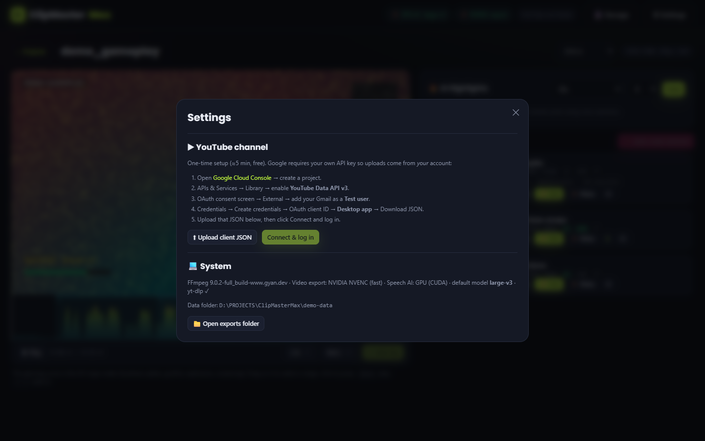

**YouTube tips** (also shown in Settings):

- **Stop getting logged out every 7 days:** publish your OAuth consent screen (set it to **In production**). Google will show an "unverified app" warning when you log in. That's fine for your own app: click **Advanced → Continue**.
- **Uploads stuck on private?** New personal API projects can only upload private videos until they pass YouTube's free [API audit](https://support.google.com/youtube/contact/yt_api_form). Until then, auto-posts land as private; make them public in YouTube Studio with one click.
- **Daily limit:** about **6 uploads per day** on the free quota.

#### 📸 Instagram Reels setup (one time, ~10 min, free)

Open **⚙ Settings → 📸 Instagram Reels** and follow these steps:

1. In the Instagram app, switch your account to a **Creator** or **Business** (Professional) account.
2. Go to [Meta for Developers](https://developers.facebook.com/) → **Create app** and choose the use case **Manage messaging & content on Instagram**.
3. In your new app, open **Instagram → API setup with Instagram login** → **Add account**. If asked, accept the tester invite in Instagram → **Settings → Website permissions → Apps and websites**.
4. Click **Generate token**.
5. Paste the token in ClipMasterMax **Settings** and click **Connect**.

The token stays only on your PC, in `data/`, and the app refreshes it automatically (each token lasts 60 days).

> 📌 Instagram allows about **50 Reels per day** through the API. Trending Instagram music can't be added through the API; if you want a trending sound, add it in the Instagram app instead.

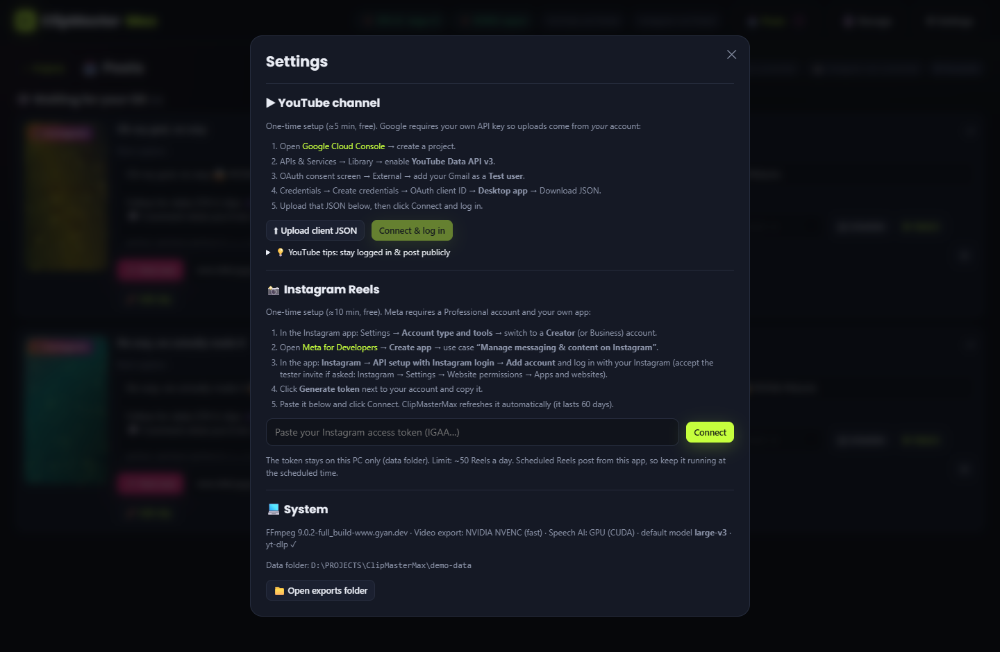

---

## 🤖 Auto Pilot: hands-free clips

Press the big pink **🤖 Auto Pilot** button on the project page. With one click it:

1. Finds the best moments in your video.
2. Applies your chosen caption style and language.
3. Reads the game screen for pop-ups (WASTED, ACE, BOOYAH…).
4. Generates captions and renders every clip.
5. Writes titles, description & tags, plus an Instagram Reel caption.
6. Queues the posts to YouTube Shorts and/or Instagram Reels.

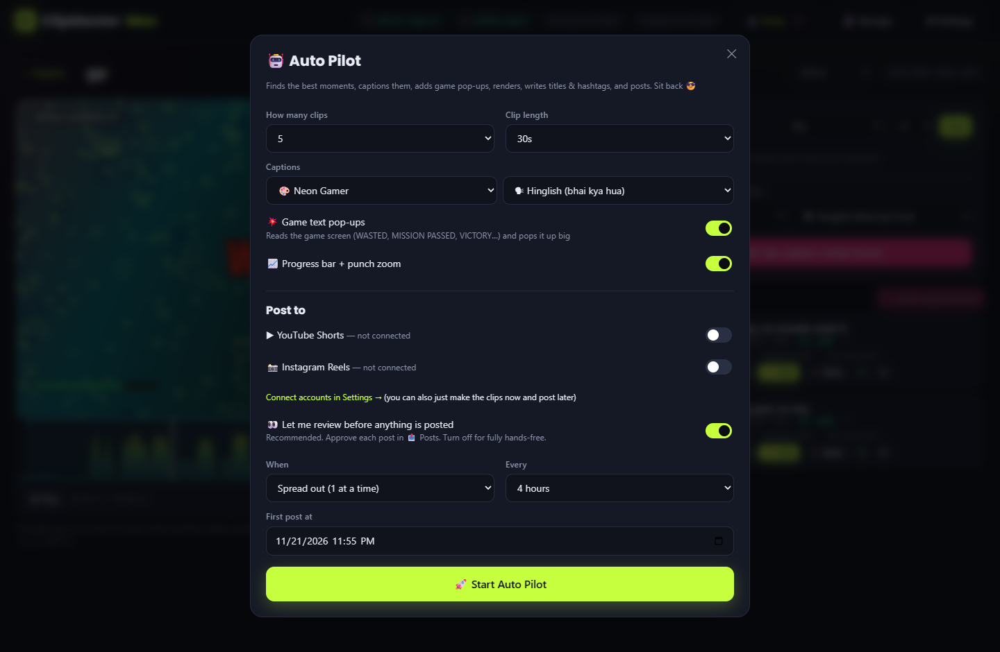

**Options in the dialog:**

| Option | What it does |
|---|---|
| How many clips | How many clips to make from this video. |
| Clip length | Length of each clip. |
| Captions | Caption style and language. |
| Game text pop-ups | Adds pop-ups from the game's own on-screen text. |
| Progress bar + punch zoom | Adds the progress bar and punch-zooms on hype moments. |
| Post to YouTube / Instagram | Only shows for accounts you've connected in Settings. |
| **Let me review before anything is posted** | **On by default.** Posts wait on the 📤 Posts page until you press OK. |
| When | **As soon as ready**, or **Spread out**: one post every N hours from a start time. |

> 🙋 **Honest advice:** fully automatic posting works (turn off *Let me review*), but we recommend keeping review on. The AI can pick a weak moment or mishear a word, and a 10-second check on the 📤 Posts page lets you fix the title or caption before your audience sees it.

---

## 💾 Freeing disk space

Source videos and exports add up quickly. Click **💾 Storage** in the top bar to see what's using space and clear it **when you decide to**:

- clips you've already uploaded
- all exports
- source videos (your clips and captions are kept)
- temporary files
- AI models

Each rendered clip also has its own **🗑 Delete file** button. **Nothing is ever deleted automatically.**

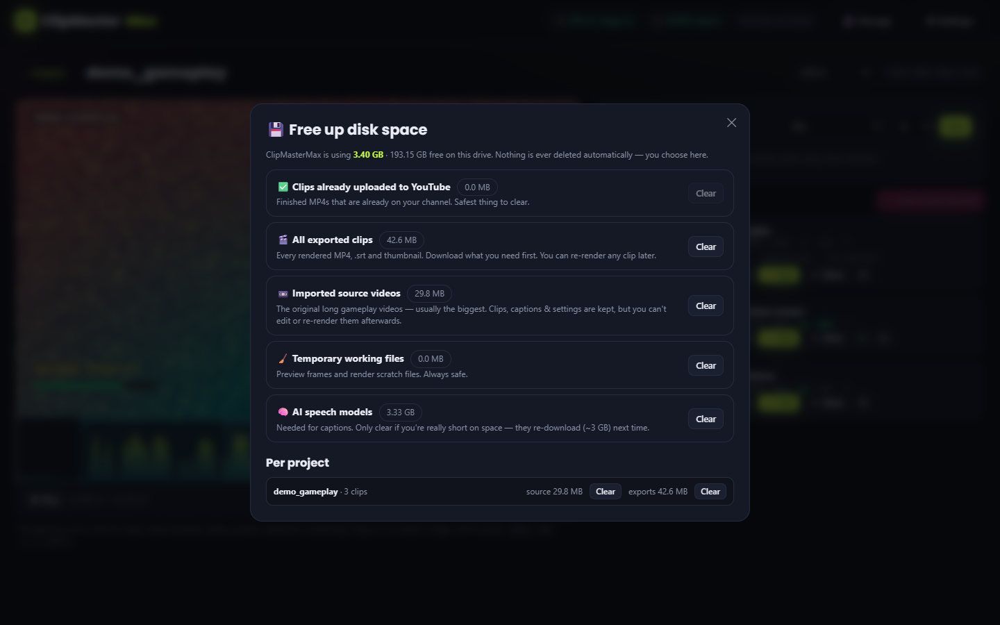

---

## 💡 Tips for more views

- **Hook in the first second.** Use the hook title ("COPS vs ME 💀", "ये क्या हो गया 😱") and start the clip *just before* the action.
- **Short is better.** 20–40 s clips get rewatched; Shorts can be up to 3 min.
- **Captions on, swears bleeped.** Most people watch muted, and clean audio keeps ads on.
- **Post consistently.** Use batch mode or Auto Pilot with **Spread out** to make 5–10 clips from one session and post them across the day.
- **OBS users:** record your mic on its own track if you can. Clean voice gives the best captions.

## ⚠️ Copyright & monetisation

- Clip **your own gameplay and streams**, or content you have permission to use. Reuploading other creators' videos gets Content ID claims and copyright strikes, and YouTube's *reused content* policy blocks monetisation.
- Rockstar generally allows monetised gameplay videos. Your commentary and edits make a clip transformative.
- Only use background music you have rights to. The [YouTube Audio Library](https://www.youtube.com/audiolibrary) is free. The built-in sound effects are generated by the app and are safe to use.

---

## 🛠 Troubleshooting

| Problem | Fix |
|---|---|
| `start.bat` says *Run setup.bat first* | Run `setup.bat` once. |
| Captions are slow the first time | The AI model is downloading (~3 GB). Later runs are fast. |
| Captions are wrong or repeat | Pick the right language instead of Auto, add names under *Names / slang*, and fix words by double-clicking. Very quiet or music-heavy audio is harder; a separate mic track helps a lot. |
| Render failed | Read the message in the job card. Common causes: the source video was deleted from Storage, or the disk is full. |
| Browser didn't open | Go to http://127.0.0.1:8765 yourself. |
| Port already in use | `start.bat` picks the next free port automatically and prints it in the console. |
| Instagram says *not a Business/Creator account* | In the Instagram app, switch your account type to **Creator** or **Business** (Professional), then generate a new token. |
| YouTube uploads are stuck on private | Your API project hasn't passed YouTube's free [API audit](https://support.google.com/youtube/contact/yt_api_form) yet. Until then, make videos public in YouTube Studio. |
| Logged out of YouTube every week | Publish your OAuth consent screen (**In production**) in Google Cloud Console, then connect again. |
| Instagram scheduled post didn't go out | The app sends Instagram posts itself, so ClipMasterMax must be running at the scheduled time. Open the 📤 Posts page and press **Retry now** or **🚀 Post now**. |

---

## 🧩 How it works (for developers)

```
app/
  main.py             FastAPI server + REST API
  core/
    ingest.py         import (upload / yt-dlp), probing, preview proxy
    highlights.py     hype detection: loudness vs local baseline + spectral flux
    transcribe.py     faster-whisper (word timestamps, Hindi/Hinglish, anti-hallucination)
    captions.py       word chunks -> styled .ass subtitles (libass)
    render.py         FFmpeg filter graph: layout, punch zoom, captions, SFX, loudnorm, NVENC
    sfx.py            built-in sound effects, generated with FFmpeg
    meta.py           title / description / tag suggestions
    youtube.py        YouTube Data API upload (OAuth, local token)
    instagram.py      Reels via the Instagram API with Instagram Login (resumable upload)
    publisher.py      post queue + background scheduler
    pipeline.py       Auto Pilot
    gametext.py       offline OCR game text pop-ups (rapidocr)
    storage.py        disk usage + manual cleanup
  static/             vanilla JS UI (live canvas preview mirrors the renderer)
  assets/fonts/       caption fonts (SIL Open Font License, see licenses/)
data/                 ALL your private stuff: projects, exports, models, settings, tokens (git-ignored)
```

Run it manually: `.venv\Scripts\python.exe -m app.main`. Optional environment variables: `CLIPMASTER_DATA` (data folder), `CLIPMASTER_PORT`, `CLIPMASTER_NO_BROWSER=1`.

**Credits:** [faster-whisper](https://github.com/SYSTRAN/faster-whisper), [FFmpeg](https://ffmpeg.org/) + libass, [yt-dlp](https://github.com/yt-dlp/yt-dlp), [FastAPI](https://fastapi.tiangolo.com/), [RapidOCR](https://github.com/RapidAI/RapidOCR), and fonts from [Google Fonts](https://fonts.google.com/) (Poppins, Anton, Bebas Neue, Bangers, Mukta, Khand, Rajdhani).
